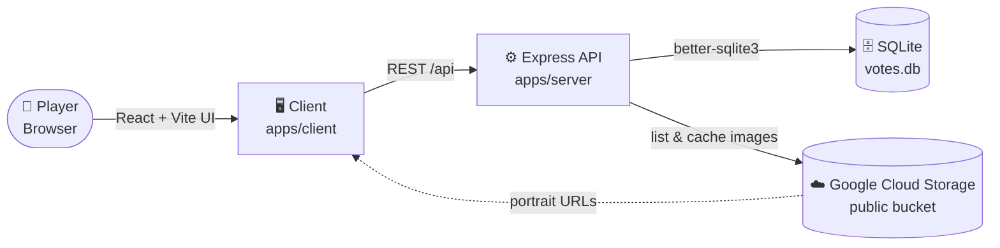

<p align="center">
  
</p>

<p align="center">
  
  
  
  
  
  
</p>

<p align="center">
  <b>🎯 A community-driven guessing game where players vote on which portraits were made by AI.</b><br/>
  🖼️ Look closely. 🤔 Make your call. 🏆 See how the crowd did.
</p>

---

## 📖 Table of Contents

- [🎮 How It Works](#-how-it-works)
- [✨ Features](#-features)
- [🧭 Architecture](#-architecture)
- [🏗️ Tech Stack](#️-tech-stack)
- [📁 Project Structure](#-project-structure)
- [🚀 Getting Started](#-getting-started)
- [⚙️ Environment Variables](#️-environment-variables)
- [🗄️ Database Management](#️-database-management)
- [🌐 API Reference](#-api-reference)
- [☁️ Deployment](#️-deployment)
- [📜 License](#-license)

---

## 🎮 How It Works

| Step | Emoji | What happens |
|:---:|:---:|---|
| **1** | 🖼️ | Browse the gallery of AI-generated portraits |
| **2** | 👀 | Click a portrait that catches your eye |
| **3** | 🗳️ | Guess who the AI was trying to portray (or pick 🤷 *I don't know*) |
| **4** | 📊 | Watch the top community guesses update |
| **5** | 🔁 | Changed your mind? Vote again. Your last vote is the one that counts |

---

## ✨ Features

| | Feature | Description |
|:---:|---|---|
| 🖼️ | **AI Portrait Gallery** | AI-generated portraits served straight from Google Cloud Storage, newest first |
| 🗳️ | **Anonymous Voting** | Open any portrait and cast your guess in a modal |
| 🔄 | **Change Your Vote** | Each browser holds one active vote per image, and changing it swaps the old one out |
| 📊 | **Live Tallies** | Vote counts and top community guesses refresh after every submission |
| 🏆 | **Leaderboard** | See which portraits have drawn the most named guesses |
| 🛡️ | **Profanity Filter** | Submitted names are screened before they are saved |
| 🔤 | **Smart Name Merging** | `ron` and `Ron` count toward the same guess |
| 💾 | **Persistent Storage** | Votes live in SQLite, so they survive restarts and redeploys |

---

## 🧭 Architecture



---

## 🏗️ Tech Stack

| Layer | Technology |
|:---|:---|
| 🎨 **Frontend** | React 19, Vite 8, Tailwind CSS 4 |
| 🧠 **Server State** | TanStack Query |
| 🎛️ **UI State** | Zustand |
| 🧩 **Icons & Routing** | Lucide React, React Router 7 |
| 🟢 **Backend** | Node.js 20, Express 4 |
| 🗄️ **Database** | SQLite via `better-sqlite3` |
| 🖼️ **Images** | Google Cloud Storage (public bucket) |
| 🚦 **Process Management** | PM2 in production, Nodemon in development |

---

## 📁 Project Structure

```
softchoice-guess-who/
├── 📂 apps/
│   ├── 🎨 client/                 # React + Vite frontend
│   │   └── src/
│   │       ├── components/        # ImageCard, VoteModal, NavBar
│   │       ├── hooks/             # useImages, useVotes
│   │       ├── pages/             # GalleryPage, LeaderboardPage
│   │       ├── services/          # API client
│   │       └── store/             # Zustand modal store
│   └── ⚙️ server/                 # Node.js + Express backend
│       └── src/
│           ├── db/                # SQLite schema & queries
│           ├── routes/            # API route handlers
│           ├── scripts/           # DB management CLI
│           └── services/          # GCS image fetching, vote logic
├── 🖼️ assets/                     # README artwork
├── 📦 package.json                # npm workspaces root
└── 📘 README.md
```

---

## 🚀 Getting Started

### ✅ Prerequisites

- 🟢 Node.js 20+
- 📦 npm 9+

### 🛠️ Install & Run

```bash
# 1. Clone the repository
git clone https://github.com/phillymontana/softchoice-guess-who.git
cd softchoice-guess-who

# 2. Install all dependencies (client + server)
npm install

# 3. Start both client and server in development mode
npm run dev
```

| 🔌 Service | 🌐 URL |
|:---|:---|
| 🖥️ Frontend | http://localhost:5173 |
| ⚙️ Backend API | http://localhost:3001/api |

---

## ⚙️ Environment Variables

Create your local config from the example:

```bash
cp apps/server/.env.example apps/server/.env
```

| 🔑 Variable | 📌 Default | 📝 Description |
|:---|:---|:---|
| `PORT` | `3001` | Backend server port |
| `NODE_ENV` | `development` | Environment mode |
| `GCS_BUCKET_URL` | *see `.env.example`* | Public GCS bucket URL |
| `GCS_CACHE_TTL_SECONDS` | `300` | How often the image list refreshes |
| `DB_PATH` | `./data/votes.db` | Path to the SQLite database file |

---

## 🗄️ Database Management

Handy CLI scripts for the SQLite database:

```bash
# 👀 View the 20 most recent vote entries
npm run db:view

# 💣 Delete ALL votes (full reset)
npm run db:clear
```

> 🔄 **Fresh demo reset:** run `npm run db:clear`, restart the server, then clear the browser's local vote history from the app's navbar.

---

## 🌐 API Reference

| Method | 🛣️ Endpoint | 📝 Description |
|:---:|:---|:---|
| `GET` | `/api/images` | 🖼️ All images, newest first |
| `GET` | `/api/votes/:imageKey` | 📊 Tallies for one image |
| `POST` | `/api/votes` | 🗳️ Submit or change a vote |
| `GET` | `/api/leaderboard` | 🏆 Top-voted images |
| `GET` | `/api/health` | 💚 Health check |

### 🗳️ `POST /api/votes`

```json
{
  "imageKey": "generated/avatars/arena_rock_1775799815951.png",
  "guessName": "David Bowie",
  "previousVoteId": 42
}
```

- 🤷 Send `"__unknown__"` as `guessName` to record an *I don't know* vote.
- 🔁 Pass `previousVoteId` to swap out an earlier vote. The browser stores the ID returned from the last submission.
- 🚫 Names longer than 100 characters, or flagged by the profanity filter, are rejected.

---

## ☁️ Deployment

Designed to run on a single **Google Compute Engine `e2-micro` VM** (⚡ always-free tier) behind **nginx**.

📘 See [deployment_guide.md](./deployment_guide.md) for the full walkthrough:

- 🖥️ VM setup and SSH access
- 🔀 nginx reverse proxy configuration
- 🔁 PM2 process management
- 🔒 Free HTTPS with Let's Encrypt

---

## 📜 License

ISC © Softchoice

<p align="center">
  <sub>Made with 🧠, ☕ and a healthy dose of 🤖 suspicion.</sub>
</p>
